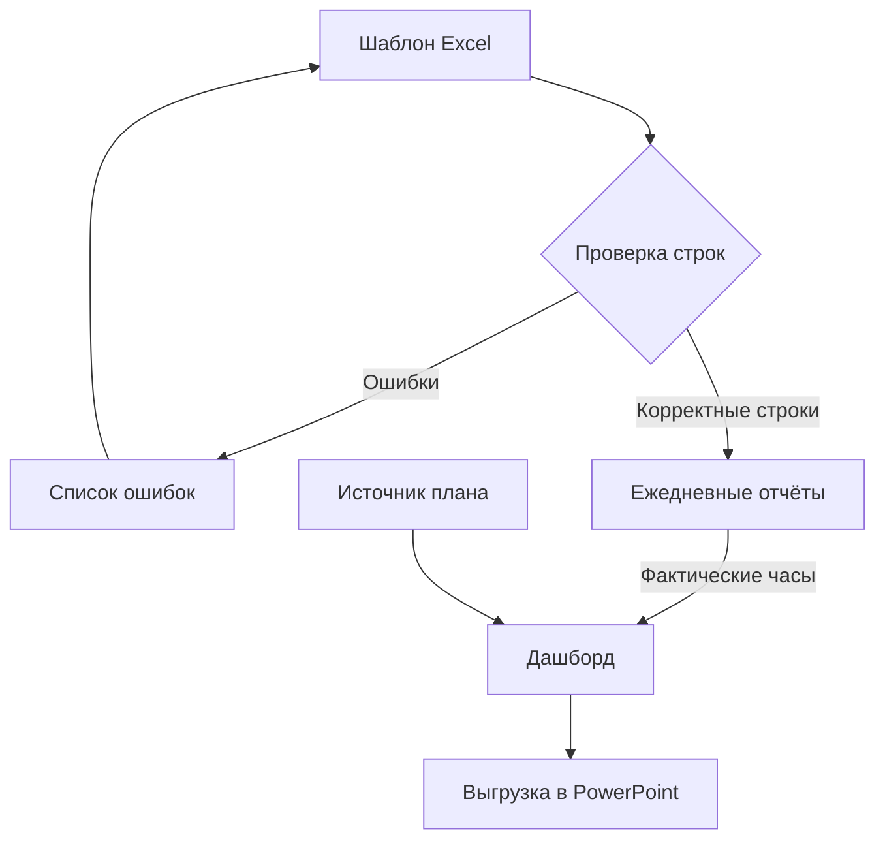

# Интеграция учёта рабочего времени с 1С:Документооборот

**Статус на 17.11.2026.** Заказчик передал конфигурацию и инструкцию по развёртыванию. Шаблон Excel подготовлен. Следующий шаг — запустить тестовую базу и проверить ежедневный отчёт. Ниже описан проектируемый сценарий импорта.

## 1. Проверка тестовой базы

| Что проверить | Что зафиксировать |
| --- | --- |
| Запуск базы | Результат запуска, редакцию и точный релиз конфигурации, версию платформы |
| Ежедневный отчёт | Путь к форме, имя и тип объекта в метаданных, доступность формы под нужной ролью |
| Ручной ввод и сохранение | Создать один тестовый отчёт. Записать, какие поля обязательны и какие заполняются автоматически |
| Сотрудник и проект | Где задаётся сотрудник — в шапке или в строке. Как выбирается проект и нужен ли отдельный выбор задачи |
| Время | Формат ввода, единицу хранения и допустимую точность |
| Данные для аналитики | Где доступны сохранённые трудозатраты, плановые часы и статусы отчёта |

Отправная точка по обзору «1С:Документооборот холдинга 3.0» (версия 3.0.19, слайды 26, 102 и 106) — раздел «Учёт времени» и форма ежедневного отчёта. В обзоре упоминаются поля «Содержание работ», «Время», «Вид работ», «Проект, задача» и отображение длительности в формате ЧЧ:ММ. Путь, названия и обязательность полей нужно сверить в полученной конфигурации.

## 2. Соответствие Excel и 1С

Источник данных — лист «Ежедневный отчет» файла `import-template.xlsx`.

| Колонка Excel | Формат в шаблоне | Что подтвердить в 1С |
| --- | --- | --- |
| Дата | Дата Excel, отображение ДД.ММ.ГГГГ | Реквизит даты отчёта и допустимый период загрузки |
| Сотрудник | Текст | Где указывается сотрудник и какой уникальный идентификатор использовать для поиска |
| Проект | Текст | Реквизит проекта и ключ поиска. Проверить, требуется ли указывать задачу |
| Фактические часы | Число, в том числе дробное | Реквизит длительности, единицу хранения и правило преобразования часов |

Если при сохранении обязательны вид или содержание работ, время начала и окончания либо другие поля, определим источник каждого значения после проверки формы. Плановые часы в текущий шаблон не входят.

## 3. Проектируемый сценарий импорта

1. Пользователь выбирает заполненный файл Excel. Точку запуска импорта и допустимые роли определим после проверки базы.
2. Импорт читает строки и проверяет заполненность полей, дату, часы, сопоставление сотрудника и проекта и возможные дубли. Неоднозначное сопоставление показывается как ошибка с указанием строки.
3. Пользователь видит результат проверки и причины ошибок. Корректные строки подготавливаются к записи. Правило записи при наличии ошибок в других строках нужно согласовать.
4. Данные записываются в ежедневные отчёты. Если сотрудник и дата задаются на уровне отчёта, строки нужно распределить по сотрудникам и датам либо ограничить загрузку одним сотрудником и одним днём на файл.
5. Дашборд получает фактические часы из согласованного источника в 1С, сопоставляет их с планом и показывает статусы при наличии согласованных правил. Руководитель выбирает период и при необходимости выгружает дашборд в PowerPoint.

## 4. Контрольный пример

| Дата | Сотрудник | Проект | Фактические часы |
| --- | --- | --- | ---: |
| 17.11.2026 | Сотрудник А | Проект 1 | 5 |
| 17.11.2026 | Сотрудник Б | Проект 1 | 2 |

После реализации импорта сверить сохранённые записи по дате, сотруднику, проекту и длительности. **Ожидаемый результат — 5 ч у сотрудника А, 2 ч у сотрудника Б, суммарный факт по проекту 7 ч.** Отдельно проверить повторную подачу файла и поведение при строке с ошибкой. При повторной загрузке факт не должен случайно увеличиться до 14 ч.

Для проверки дашборда можно использовать согласованный тестовый план 4 ч для А и 2 ч для Б. На этих данных ожидаются план 6 ч, факт 7 ч и отклонение +1 ч. Тестовый план задан отдельно от Excel.

## 5. Решения после проверки базы

- Где запускать импорт и каким способом подключать доработку. Проверить возможность расширения конфигурации и доступность клиентской или серверной обработки Excel.
- Кто вправе загружать данные за других сотрудников. Определить, допустим ли один файл на несколько сотрудников или дат.
- По каким ключам искать сотрудника и проект, как определять дубли и что делать при повторной загрузке. Уточнить допустимый диапазон часов и правила частичного импорта.
- Из какого объекта брать факт для дашборда. Проверить, есть ли готовый регистр трудозатрат или потребуется использовать данные ежедневных отчётов.
- Где брать план и статусы. Согласовать, какие отчёты входят в факт и как отображать отсутствие отчёта.
- Кто устанавливает и проверяет доработки на тестовой базе, какие права нужны для импорта и просмотра аналитики.
