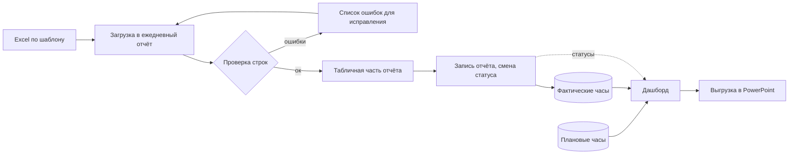

# Подключение доработки к 1С:Документооборот КОРП 3.0

Статус: черновик до получения доступа к конфигурации. Всё, что описано как «ожидаемое», нужно подтвердить в тестовой базе.

## 0. Что уже известно из обзора программы

Источник: презентация «Обзор программы 1С:Документооборот холдинга 3.0» (версия 3.0.19), слайды 26, 102, 106. Обзор написан для редакции «Документооборот холдинга», а проект ведётся на КОРП 3.0, поэтому всё ниже нужно сверить в нашей базе.

- В программе есть штатная подсистема учёта рабочего времени: фиксация трудозатрат за день и неделю, автоматические отметки времени при выполнении задач, отчётность для руководителей подразделений.
- В интерфейсе это раздел **«Учёт времени»**: «Мои ежедневные отчёты», «Мои отчёты», «Мои трудозатраты», «Виды работ», «Все ежедневные отчёты», «Отчёты». Создаётся отчёт командой «Ежедневный отчёт», в «Сервисе» есть «Дополнительные обработки».
- Форма **«Ежедневный отчёт за <дата>»**: дата отчёта, время начала и окончания, продолжительность; кнопки «Подобрать работы» и «Добавить»; табличная часть со столбцами «Содержание работ», «Время», «Вид работ», «Проект, задача»; итог «Всего, в т. ч. рабочее».
- Время в отчёте показано в формате ЧЧ:ММ (например, 03:00), а не десятичными часами. Это важно для шаблона Excel и для расчётов дашборда.
- Трудозатраты можно учитывать и по работе с файлами, формы учёта времени есть в мобильном клиенте.
- Информации о плановых часах и статусах ежедневного отчёта в обзоре нет, это остаётся главным открытым вопросом.

## 1. Ожидаемый сценарий (путь данных)

1. Сотрудник заполняет Excel-файл по шаблону (дата, содержание работ, время, вид работ, проект/задача, при необходимости плановые часы).
2. В разделе «Учёт времени» сотрудник открывает или создаёт ежедневный отчёт за нужную дату и запускает загрузку из Excel (точка входа: кнопка на форме отчёта или обработка в «Сервис → Дополнительные обработки», уточнить).
3. Система читает строки и проверяет их: заполнены обязательные поля, время в допустимом формате и диапазоне, вид работ и проект найдены в справочниках, нет дублей за день.
4. Пользователь видит результат проверки: корректные строки попадают в табличную часть отчёта, строки с ошибками показываются списком с причиной и не загружаются.
5. Сотрудник исправляет данные и сохраняет отчёт («Записать» / «Записать и закрыть»); статус отчёта, если он есть, меняется.
6. Фактическое время из сохранённых отчётов становится источником для дашборда. Плановые часы и статусы дашборд берёт из своих источников (см. раздел 2, пункты 4–5).
7. Руководитель открывает дашборд, выбирает период и видит план/факт, загрузку, детализацию и отклонения; при необходимости выгружает дашборд в PowerPoint.

### Схема

## 2. Что проверить в конфигурации первым делом

Порядок: сверху вниз, пункты 1–2 блокируют всё остальное.

1. **Совпадает ли наша база с обзором.** Есть ли в КОРП 3.0 раздел «Учёт времени» и форма «Ежедневный отчёт» в том виде, как на слайдах 102–103. Имя объекта метаданных (документ или другой тип), путь в интерфейсе, версия конфигурации.
2. **Структура отчёта.** Реквизиты шапки (дата, время начала и окончания, продолжительность) и табличной части («Содержание работ», «Время», «Вид работ», «Проект, задача»): типы, обязательность, что обязательно при записи. Как «Время» хранится (число часов, длительность в секундах, дата-время).
3. **Как определяются сотрудник и проект.** Кто автор отчёта (текущий пользователь или выбираемый сотрудник), какие справочники (Пользователи, Проекты, Виды работ), как связаны с «Проект, задача», по какому ключу искать при загрузке (наименование, код), есть ли дубли.
4. **Источник плановых часов.** Есть ли плановые трудозатраты в задачах, проектах или процессах (срок, плановое время), или план придётся хранить отдельно (в Excel, в регистре, в отдельной обработке). В обзоре информации нет.
5. **Статусы.** Есть ли у ежедневного отчёта состояния, какой набор, где хранятся, как отличить «не заполнен», «записан», «проверен». Возможно, «статус» придётся вычислять (отчёт за день есть или нет, часы соответствуют норме).
6. **Хранение факта.** Есть ли готовый регистр трудозатрат (раздел «Мои трудозатраты», «Отчёты» — на чём построены) или достаточно запросов к табличной части отчётов.
7. **Роли и права.** Кто создаёт отчёты, кто видит чужие («Все ежедневные отчёты»), кто смотрит дашборд; какие роли добавить или изменить.
8. **Механизмы загрузки и дашборда.** Как открыть и разобрать Excel в этой версии (клиент или сервер), и чем строятся отчёты и аналитика (СКД, формы с диаграммами).
9. **Расширение или доработка конфигурации.** Можно ли дорабатывать через расширение, есть ли ограничения на изменение типовой конфигурации.
10. **Тестовая база и процесс.** Кто устанавливает и проверяет доработки, как переносятся изменения, есть ли тестовые данные.

## 3. Вопросы к заказчику / владельцу базы

- Где открывается ежедневный отчёт? (Предположительно «Учёт времени → Мои ежедневные отчёты», подтвердить.)
- Какие поля обязательны?
- Как в конфигурации определяются сотрудник и проект?
- Откуда брать плановые часы и статусы?
- Кто сможет устанавливать и проверять доработки в тестовой базе?

## 4. Колонки шаблона Excel: что подтвердить в 1С

Черновик колонок от Виктории на момент составления документа не получен. Когда он появится, для каждой колонки проверить соответствие реквизиту 1С. Ориентир — поля формы отчёта из обзора. Особенно важны:

| Колонка | Что подтвердить |
| --- | --- |
| Дата | Реквизит «Отчёт за»; формат; допустимы ли прошлые даты; один файл на один день или несколько дней |
| Сотрудник | Автор отчёта; отдельная колонка или текущий пользователь |
| Проект, задача | Поле «Проект, задача»: тип значения (проект, задача или оба), ключ поиска, уникальность |
| Вид работ | Справочник «Виды работ»; обязательность; как сопоставлять наименование |
| Содержание работ | Поле «Содержание работ»: свободный текст, обязательность, длина |
| Время (факт) | Поле «Время»: формат ЧЧ:ММ или десятичные часы, допустимый максимум за день |
| Плановые часы | Откуда берутся: из файла или из 1С (в форме отчёта такого поля нет) |
| Начало и окончание дня | Нужны ли в файле или берутся из шапки отчёта |

## 5. Открытые вопросы

- Загружаются ли плановые часы из Excel или берутся из 1С?
- В каком формате передавать время в Excel: ЧЧ:ММ или десятичные часы?
- Нужно ли поддерживать повторную загрузку за тот же день (замена или добавление)?
- Какие статусы нужны дашборду для блока «Мониторинг статусов и отклонений»?
- Совпадает ли поведение КОРП 3.0 с обзором «Документооборота холдинга»?