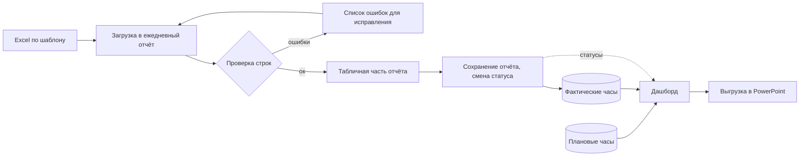

# Подключение доработки к 1С:Документооборот КОРП 3.0

Статус: черновик до получения доступа к конфигурации. Всё, что описано как «ожидаемое», нужно подтвердить в тестовой базе.

## 1. Ожидаемый сценарий (путь данных)

1. Сотрудник заполняет Excel-файл по шаблону (проект, задача, плановые и фактические часы, комментарий за день).
2. В ежедневном отчёте сотрудник запускает «Загрузить из Excel» и выбирает файл.
3. Система читает строки и проверяет их: заполнены обязательные поля, часы — число в допустимом диапазоне, сотрудник и проект найдены в справочниках, нет дублей за день.
4. Пользователь видит результат проверки: корректные строки попадают в табличную часть отчёта, строки с ошибками показываются списком с причиной и не загружаются.
5. Сотрудник исправляет данные и сохраняет (проводит) отчёт; статус отчёта меняется.
6. Фактические часы из сохранённых отчётов становятся источником для дашборда. Плановые часы и статусы дашборд берёт из своих источников (см. раздел 3).
7. Руководитель открывает дашборд, выбирает период и видит план/факт, загрузку, детализацию и отклонения; при необходимости выгружает дашборд в PowerPoint.

### Схема

## 2. Что проверить в конфигурации первым делом

Порядок: сверху вниз, пункты 1–2 блокируют всё остальное.

1. **Где открывается ежедневный отчёт.** Есть ли он в стандартной конфигурации (вид документа, отчёт, бизнес-процесс) или его нужно создавать. Путь в интерфейсе, имя объекта метаданных, форма.
2. **Структура отчёта.** Шапка и табличная часть, реквизиты, типы, обязательность. Какие поля обязательны при сохранении.
3. **Как определяются сотрудник и проект.** Какие справочники (Пользователи / Сотрудники / Проекты), как связаны, по какому ключу искать при загрузке (ФИО, логин, код, наименование) и есть ли дубли.
4. **Источник плановых часов.** Есть ли плановые трудозатраты в задачах/проектах/процессах, или план придётся вводить отдельно (в самом отчёте, в Excel, в отдельном регистре).
5. **Статусы.** Есть ли у отчёта состояния/статусы, какой набор, где хранятся, как отличить «не сдан», «сдан», «утверждён».
6. **Хранение факта.** Нужен ли регистр сведений/накопления для часов или достаточно запросов к табличной части отчётов.
7. **Роли и права.** Кто создаёт отчёты, кто видит чужие, кто смотрит дашборд; какие роли добавить или изменить.
8. **Механизмы загрузки и дашборда.** Доступна ли работа с Excel на клиенте или сервере, и чем в этой версии строятся дашборды/аналитика.
9. **Расширение или доработка конфигурации.** Можно ли дорабатывать через расширение, есть ли ограничения на изменение типовой конфигурации.
10. **Тестовая база и процесс.** Кто устанавливает и проверяет доработки, как переносятся изменения, есть ли тестовые данные.

## 3. Вопросы к заказчику / владельцу базы

- Где открывается ежедневный отчёт?
- Какие поля обязательны?
- Как в конфигурации определяются сотрудник и проект?
- Откуда брать плановые часы и статусы?
- Кто сможет устанавливать и проверять доработки в тестовой базе?

## 4. Колонки шаблона Excel: что подтвердить в 1С

Черновик колонок от Виктории на момент составления документа не получен. Когда он появится, для каждой колонки проверить соответствие реквизиту 1С. Особенно важны:

| Колонка | Что подтвердить |
| --- | --- |
| Дата | Реквизит отчёта или строки; формат; допустимы ли прошлые даты |
| Сотрудник | Справочник и ключ поиска; отдельная колонка или текущий пользователь |
| Проект | Справочник, ключ поиска (код или наименование), уникальность |
| Задача / вид работ | Есть ли такой справочник или это свободный текст |
| Плановые часы | Откуда берутся: из файла или из 1С |
| Фактические часы | Тип (число), точность, допустимый максимум за день |
| Комментарий | Обязательность, длина |

## 5. Открытые вопросы

- Загружаются ли плановые часы из Excel или берутся из 1С?
- Нужно ли поддерживать повторную загрузку за тот же день (замена или добавление)?
- Какие статусы нужны дашборду для блока «Мониторинг статусов и отклонений»?
